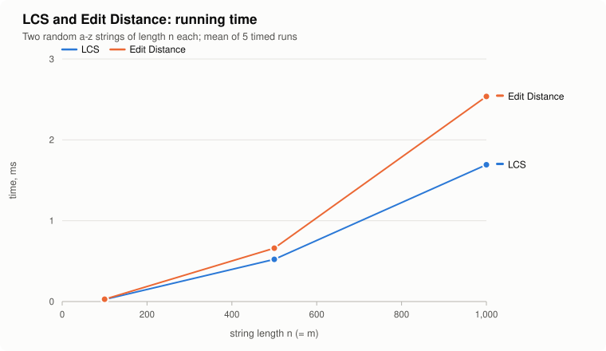
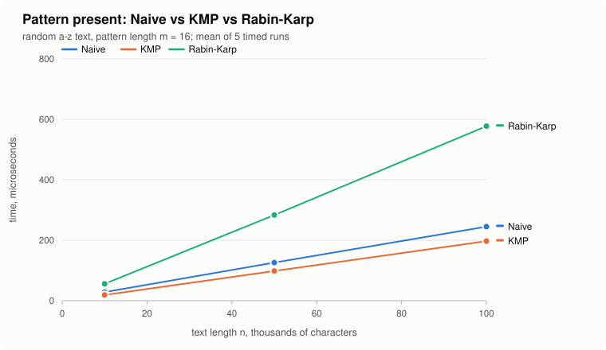
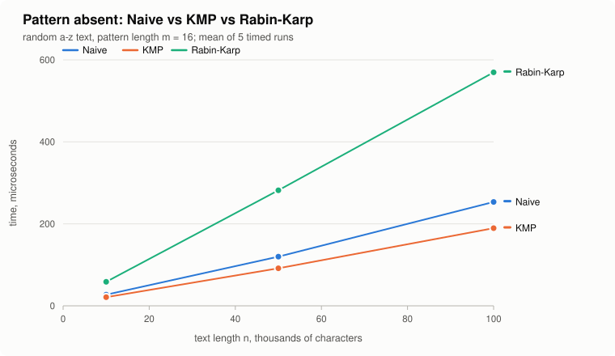
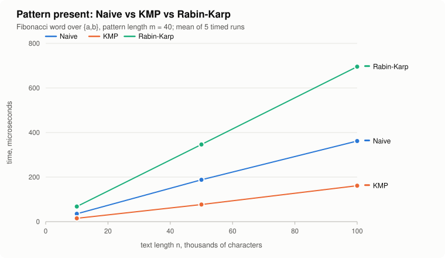
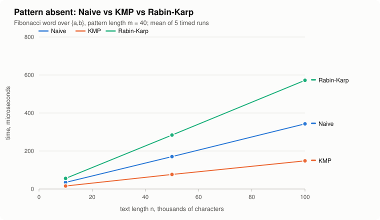
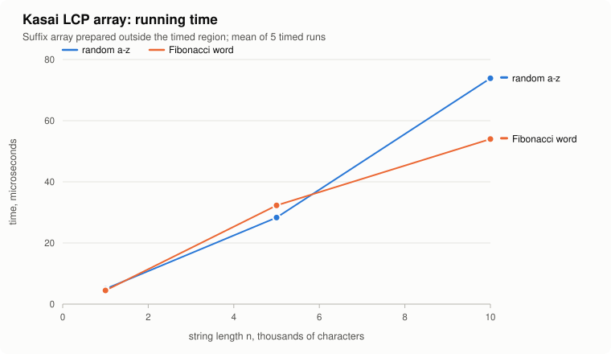

# Text Algorithms Lab — Dynamic Programming and String Matching in Java

Assignment 4 · Design and Analysis of Algorithms

This repository implements, tests and benchmarks six classic text algorithms in plain Java 17:

| Part | Algorithms | Package |
|---|---|---|
| A. Dynamic programming | Longest Common Subsequence, Edit (Levenshtein) Distance | `io.github.ignat22.textlab.dp` |
| B. String matching | Naive, Knuth–Morris–Pratt, Rabin–Karp | `io.github.ignat22.textlab.search` |
| C. Advanced | Kasai's LCP array (plus a prefix-doubling suffix array used to feed it) | `io.github.ignat22.textlab.suffix` |

The project has **no external dependencies**: it compiles and runs with the JDK alone, including the test framework and the plots (SVG charts are produced by the benchmark itself).

**Quick start**

```bash
sh lab.sh test     # build + 47 automated checks
sh lab.sh demo     # small worked examples of every algorithm
sh lab.sh bench    # experiments -> results/*.csv, results/RESULTS.md, plots/*.svg
```

On Windows (PowerShell): `powershell -ExecutionPolicy Bypass -File lab.ps1 test` (also `demo`, `bench`, `all`).

---

## Contents

1. [Problem description and algorithm overview](#1-problem-description-and-algorithm-overview)
2. [Implementation decisions and assumptions](#2-implementation-decisions-and-assumptions)
3. [Complexity analysis](#3-complexity-analysis)
4. [Testing strategy and results](#4-testing-strategy-and-results)
5. [Experimental setup and timing methodology](#5-experimental-setup-and-timing-methodology)
6. [Results: tables and plots](#6-results-tables-and-plots)
7. [Theory versus experiment](#7-theory-versus-experiment)
8. [Conclusion: trade-offs](#8-conclusion-trade-offs)
9. [Build, run, repository layout and Git workflow](#9-build-run-repository-layout-and-git-workflow)

---

## 1. Problem description and algorithm overview

Text analysis tools (diff utilities, spell checkers, plagiarism detectors, search engines, DNA aligners) answer three kinds of questions:

* **How similar are two strings?** — LCS and Edit Distance (Part A).
* **Where does a pattern occur in a text?** — Naive, KMP, Rabin–Karp (Part B).
* **What repeated structure does one string contain?** — suffix array + LCP array (Part C).

### 1.1 Longest Common Subsequence

A *subsequence* keeps characters in order but may skip some (`ACE` is a subsequence of `ABCDE`). Given strings `X` (length n) and `Y` (length m), find the length of the longest string that is a subsequence of both.

Let `L[i][j]` be the LCS length of the prefixes `X[0..i)` and `Y[0..j)`.

```
L[0][j] = 0,  L[i][0] = 0                                   (an empty prefix shares nothing)
L[i][j] = L[i-1][j-1] + 1                if X[i-1] == Y[j-1]
L[i][j] = max(L[i-1][j], L[i][j-1])      otherwise
```

**Why the recurrence is correct.** Look at the last characters of the two prefixes.

* If they are equal, some optimal common subsequence ends with that character: if an optimal one did not use it, we could swap its last character for this pair without making it shorter. Removing the pair leaves an optimal solution for `(i-1, j-1)` — this is the *optimal substructure* property.
* If they differ, they cannot both be the last character of a common subsequence, so at least one of them is unused; the answer is the better of dropping `X[i-1]` or dropping `Y[j-1]`.

Every case refers only to strictly smaller prefixes, so filling the table row by row (top-down for `i`, left-to-right for `j`) always uses values that are already final. `L[n][m]` is the answer.

Worked example (`X = ABCB`, `Y = BDCAB`; this exact table is checked by a unit test):

|   | ε | B | D | C | A | B |
|---|---|---|---|---|---|---|
| ε | 0 | 0 | 0 | 0 | 0 | 0 |
| A | 0 | 0 | 0 | 0 | 1 | 1 |
| B | 0 | 1 | 1 | 1 | 1 | 2 |
| C | 0 | 1 | 1 | 2 | 2 | 2 |
| B | 0 | 1 | 1 | 2 | 2 | **3** |

The implementation also **reconstructs one LCS** (`LcsResult.witness`) by walking back from `L[n][m]`: on a match it takes the character and moves diagonally, otherwise it moves towards the larger neighbour (up on ties). For `ABCBDAB / BDCABA` it returns `BCBA` (length 4).

### 1.2 Edit Distance (Levenshtein)

The minimum number of single-character **insertions, deletions and substitutions** that turn `S` (length n) into `T` (length m). Let `D[i][j]` be the distance between `S[0..i)` and `T[0..j)`.

```
D[i][0] = i                     (delete all i characters)
D[0][j] = j                     (insert all j characters)
D[i][j] = min( D[i-1][j-1] + (S[i-1] == T[j-1] ? 0 : 1),    keep or substitute
               D[i-1][j]   + 1,                             delete S[i-1]
               D[i][j-1]   + 1 )                            insert T[j-1]
```

**Why it is correct.** Consider an optimal alignment of the two prefixes and its *last column*. There are exactly three possibilities: `S[i-1]` is aligned with `T[j-1]` (cost 0 if equal, 1 for a substitution), `S[i-1]` is deleted, or `T[j-1]` is inserted. Whatever happens in the last column, the rest of the alignment must be an optimal alignment of the remaining prefixes (otherwise replacing it with a cheaper one would improve the whole). Taking the minimum over the three cases therefore gives the optimum. The base cases are forced: transforming into or from an empty string can only insert or delete.

Besides the number, `EditDistanceSolver.solve` returns an **edit script** — the list of operations recovered by backtracking through the table. The script is executable (`EditScript.applyTo(source)` produces the target), which is how the tests verify the reconstruction. Example from `demo`:

```
kitten -> sitting, distance 3
  replace 'k' with 's', keep 'i', keep 't', keep 't', replace 'e' with 'i', keep 'n', insert 'g'
```

### 1.3 Naive string matching

Try every shift `s = 0 … n−m` and compare `pattern[0..m)` with `text[s..s+m)` left to right, stopping at the first mismatch. Simple, no preprocessing, and the baseline for the other two algorithms.

### 1.4 Knuth–Morris–Pratt

KMP precomputes the **border table** (also called prefix function / LPS table): `border[q]` is the length of the longest proper prefix of `pattern[0..q]` that is also a suffix of it. For `ababaca` the table is `0 0 1 2 3 0 1`.

During the scan KMP keeps `state` = number of pattern characters currently matched.

* On a match: `state++`. If `state == m`, report `i − m + 1` and continue from `state = border[m−1]` (so overlapping matches are found).
* On a mismatch with `state > 0`: fall back to `state = border[state−1]` and compare the same text character again.
* On a mismatch with `state == 0`: move to the next text character.

**How KMP avoids repeated comparisons.** When a mismatch happens after `q` matched characters, the last `q` text characters are already known — they equal `pattern[0..q)`. The naive algorithm would forget this, shift by one and re-read most of them. KMP instead shifts the pattern so that its longest border lines up with the end of the matched part; every shift in between is provably impossible (it would require a longer border). As a result **the text index never moves backwards**, and each text character is read once on success, plus once per fallback.

### 1.5 Rabin–Karp

Rabin–Karp compares **numbers instead of strings**. A window `c₀c₁…c_{m−1}` gets the polynomial hash

```
h = (c₀·B^(m−1) + c₁·B^(m−2) + … + c_{m−1}) mod q
```

and the next window's hash is obtained in O(1) by a **rolling update**:

```
h' = ((h − c_out · B^(m−1)) · B + c_in) mod q
```

Implementation choices (different from the textbook `mod 101` example):

* modulus `q = 2^61 − 1` (a Mersenne prime) and base `B = 1,000,003`;
* the 122-bit product `a·b` is reduced without division: `Math.multiplyHigh` gives the high 64 bits, and because `2^61 ≡ 1 (mod q)` the reduction is just shifts, masks and additions;
* a constructor `RabinKarpSearcher(base, modulus)` accepts any modulus up to 2³¹−1, which the tests use to *force* collisions.

**How hash collisions are handled.** Equal hashes do not prove equal strings. Every *hash hit* is verified character by character; only a full match is reported. A hit that fails verification is a *spurious hit* and is counted in `SearchCounters.spuriousHits`. Correctness therefore never depends on the hash; only the running time does. With `q ≈ 2.3·10¹⁸` the expected number of spurious hits in a 100,000-character text is about `10⁵ / q ≈ 4·10⁻¹⁴` — and indeed it was 0 in every experiment. With modulus 7 in the tests there are thousands of spurious hits, and the output is still exactly the same as Naive's.

### 1.6 Kasai's algorithm for the LCP array

The **suffix array** `SA` of a string `s` lists the starting positions of all suffixes in lexicographic order. The **LCP array** stores, for every position `i ≥ 1` of the suffix array, the length of the longest common prefix of the suffixes `SA[i−1]` and `SA[i]` (neighbours in sorted order). By convention `LCP[0] = 0`.

**What the LCP array represents.** Because sorted order groups suffixes that start the same way, *every repeated substring shows up as a common prefix of two neighbouring suffixes*. Hence:

* `max(LCP)` = length of the longest repeated substring (`abra` in `abracadabra`, length 4);
* number of distinct substrings = `n(n+1)/2 − Σ LCP` (54 for `abracadabra`);
* together with `SA` it supports pattern search, longest common substring of two texts, etc.

Hand-verified example used in the tests (`s = abracadabra`, n = 11):

| i | SA[i] | suffix | LCP[i] | common prefix with the previous suffix |
|---:|---:|---|---:|---|
| 0 | 10 | a | 0 | — |
| 1 | 7 | abra | 1 | `a` |
| 2 | 0 | abracadabra | 4 | `abra` |
| 3 | 3 | acadabra | 1 | `a` |
| 4 | 5 | adabra | 1 | `a` |
| 5 | 8 | bra | 0 | — |
| 6 | 1 | bracadabra | 3 | `bra` |
| 7 | 4 | cadabra | 0 | — |
| 8 | 6 | dabra | 0 | — |
| 9 | 9 | ra | 0 | — |
| 10 | 2 | racadabra | 2 | `ra` |

**Kasai's idea.** Computing each LCP from scratch costs up to O(n) per pair, O(n²) in total. Kasai processes suffixes in **text order** `i = 0, 1, …, n−1` (not in suffix-array order) and keeps a counter `h`. Key lemma: if the suffix at `i` shares `h > 0` characters with its predecessor in `SA`, then the suffix at `i+1` shares **at least `h − 1`** characters with *its* predecessor (drop the first character of both suffixes; the shorter pair stays sorted and still shares `h−1` characters, and the real predecessor of `i+1` is between them in sorted order). So after each step the algorithm only decreases `h` by one and continues comparing from there instead of from zero.

```
rank[SA[p]] = p                      for all p
h = 0
for i in 0..n-1:
    p = rank[i]
    if p == 0: h = 0; continue
    j = SA[p-1]
    while i+h < n and j+h < n and s[i+h] == s[j+h]: h++
    LCP[p] = h
    if h > 0: h--
```

The suffix array itself is outside the scope of the assignment; `SuffixArrays.byPrefixDoubling` (O(n log² n)) builds it for the experiments and `SuffixArrays.bySortingSuffixes` (direct comparison sort) is kept as an independent cross-check in the tests. Neither is timed.

---

## 2. Implementation decisions and assumptions

**Code structure**

* `dp` — `LcsSolver` and `EditDistanceSolver` are static, stateless utilities. Each exposes the raw table (`buildTable`), the number only (`length` / `distance`, used for timing) and a rich result (`solve`) with reconstruction: `LcsResult(length, witness, cellsFilled)` and `EditScript(distance, steps, cellsFilled)`.
* `search` — the three matchers extend one abstract class `PatternSearcher`. It is a *template method*: the public `search(text, pattern)` validates input and handles the edge cases **once**, then calls the algorithm-specific `scan(...)`. This guarantees that all three algorithms follow identical conventions. The result is a `SearchReport(algorithm, positions, counters)`.
* `suffix` — `KasaiLcp.build(s, suffixArray)` returns `LcpResult(lcp, comparisons)`; `LcpResult` also derives `max()`, `average()` and `distinctSubstrings()`.
* `bench` — seeded workload generator, stopwatch, CSV/Markdown table writer and the experiment suite.
* `chart` — a small SVG line-chart renderer, so the plots are regenerated by `bench` with no Python or plotting library.
* Source code intentionally contains no comments; names are chosen to be self-explanatory and this README carries the full explanation.

**Conventions and assumptions**

| Situation | Behaviour | Reason |
|---|---|---|
| Empty pattern | matches at **every index 0…n** (n+1 positions); for an empty text the answer is `[0]` | the empty string is a prefix of every suffix, including the empty suffix at index n; consistent with `"abc".indexOf("", k) == k` |
| Pattern longer than text | empty list, no comparisons | no window of length m exists |
| Overlapping matches | all reported (`aa` in `aaaaa` → `0,1,2,3`) | standard definition of "all occurrences" |
| Indices | 0-based starting positions, ascending | |
| `null` arguments | `NullPointerException` | fail fast instead of silently returning nothing |
| Characters | Java `char` (UTF-16 code unit); any alphabet works | hashing uses the char code as the digit |
| LCS witness | one LCS is returned (ties broken by moving up) | LCS is not unique; the length is |
| Edit operations | unit cost for insert, delete, substitute | Levenshtein definition |
| `LCP[0]` | 0 | no predecessor |
| Invalid suffix array | `IllegalArgumentException` (wrong length, duplicate, out of range) | Kasai's correctness depends on the input being a permutation |
| Operation counting | every algorithm counts its character comparisons in a local `long` and stores it once | negligible and *equal* overhead for all algorithms |

**Operation counters**

* Naive / KMP / Rabin–Karp: *scan comparisons* (pattern vs text characters) and *setup comparisons* (KMP border table). Rabin–Karp also reports *hash hits* and *spurious hits*; its scan comparisons are verification comparisons only.
* LCS / Edit Distance: *cells filled* (= n·m).
* Kasai: character comparisons inside the `while` loop.

---

## 3. Complexity analysis

Notation: n = text (or first string) length, m = pattern (or second string) length, k = number of occurrences, σ = alphabet size. *Auxiliary space* excludes the input strings and the output list of positions (O(k)).

| Algorithm | Main operation / recurrence | Best-case time | Worst-case time | Auxiliary space | Justification |
|---|---|---|---|---|---|
| **LCS** | `L[i][j] = L[i−1][j−1]+1` on match, else `max(L[i−1][j], L[i][j−1])` | Θ(n·m) | Θ(n·m) | Θ(n·m) | All (n+1)(m+1) cells are filled once, O(1) each, regardless of content. Reconstruction adds O(n+m). |
| **Edit Distance** | `D[i][j] = min(D[i−1][j−1]+[≠], D[i−1][j]+1, D[i][j−1]+1)` | Θ(n·m) | Θ(n·m) | Θ(n·m) | Same table shape; each cell is a minimum of three values. Base row/column O(n+m); backtracking O(n+m). |
| **Naive** | compare `pattern[j]` with `text[s+j]` for each shift `s` | Θ(n) — first character mismatches at every shift | Θ((n−m+1)·m) = O(n·m) — e.g. `aaaa…a` / `aa…ab` | Θ(1) | n−m+1 shifts, each costing between 1 and m comparisons; no preprocessing. |
| **KMP — preprocessing** | border table: extend `width` or fall back to `border[width−1]` | Θ(m) | Θ(m) | Θ(m) | `width` grows by ≤ 1 per step and every fallback decreases it, so the total number of comparisons is < 2m. |
| **KMP — search** | match → `state++`; mismatch → `state = border[state−1]` | Θ(n) | Θ(n) | Θ(m) for the table | The text index only advances. Every comparison either advances `i` (≤ n times) or decreases `state`, which can drop at most as many times as it grew (≤ n). Total ≤ 2n comparisons; overall **Θ(n + m)**. |
| **Rabin–Karp — preprocessing** | Horner hash of pattern and first window, `B^(m−1)` | Θ(m) | Θ(m) | Θ(1) | One pass over m characters, O(1) modular work each. |
| **Rabin–Karp — search** | rolling hash; verify on hash hit | Θ(n) — no hash hits | Θ((n−m+1)·m) = O(n·m) | Θ(1) | n−m+1 O(1) roll updates, plus up to m comparisons per hit. **Expected Θ(n + m + k·m)** for a random-like hash: spurious hits ≈ (n−m+1)/q. **Worst case O(n·m)** when almost every window hits: many real matches (`aaaa…` / `aaa`) or a bad modulus / adversarial input. |
| **Kasai** | `h` = LCP with SA-predecessor, reused as `h − 1` for the next text position | Θ(n) | Θ(n) | Θ(n) — `rank` array (+ n-int output) | `h ≤ n` and decreases by at most 1 per iteration (≤ n decrements), so it increases at most 2n times; plus ≤ n mismatching comparisons → **≤ 3n comparisons**. Building `rank` is Θ(n). |
| *Suffix array (helper)* | prefix doubling: sort by (rank[i], rank[i+2ᵏ]) | Θ(n log n) | Θ(n log² n) | Θ(n) | ⌈log n⌉ rounds, each an O(n log n) comparison sort. Not part of the timed experiments. |

**Theoretical complexity vs measured time.** The table above counts abstract steps. Measured wall-clock time also includes the cost per step (a modular multiplication is more expensive than a `char` comparison), memory and cache behaviour, branch prediction and JIT compilation. Section 7 compares both: operation counts are expected to match theory almost exactly, while times only follow the *growth rate*.

**Expected vs worst case.** Only Rabin–Karp (and Naive, on random input) has a gap between the typical and the worst case:

* *Rabin–Karp*: the O(n + m) bound is an **expectation** over the behaviour of the hash; a guaranteed bound does not exist because collisions cannot be excluded. The worst case is reached by input with many real occurrences (verification cost k·m) or by a weak modulus.
* *Naive*: on random text over σ letters the expected number of comparisons per shift is `1 + 1/σ + 1/σ² + … < σ/(σ−1)`, i.e. ≈ 1.04 for σ = 26, so the **expected** time is Θ(n). The worst case Θ(n·m) appears only on repetitive text.

KMP, LCS, Edit Distance and Kasai have no such gap: their best and worst cases coincide asymptotically.

**Space optimisation (not used).** LCS and Edit Distance values need only the previous row, so O(min(n, m)) space is possible. This implementation keeps the full table on purpose, because the assignment asks for a DP table and because the full table is required to reconstruct the LCS and the edit script.

---

## 4. Testing strategy and results

The tests live in `src/test/java`. A tiny self-written framework (`testkit`: `@Check` annotation, `Expect` assertions and a reflective `TestLauncher`) keeps the project dependency-free; the launcher prints PASS/FAIL per check and exits with code 1 on any failure.

Three kinds of checks are used:

1. **Required edge cases** with hand-computed answers.
2. **Cross-implementation agreement**: every string-matching check runs **all three** algorithms through one helper (`allFind`) and requires the same list of positions.
3. **Randomised oracles** with fixed seeds: a memoised top-down LCS, `String.indexOf` for matching, a brute-force LCP, `BigInteger` for Mersenne arithmetic, and direct suffix sorting for the suffix array. (The oracles use library methods only inside tests, which the assignment allows.)

| Suite | Checks | What is covered |
|---|---:|---|
| `LcsTests` | 8 | identical strings, completely different strings, empty string (each side and both), CLRS example, full hand-computed DP table, symmetry and bounds, 300 random pairs vs top-down recursion (witness checked to be a common subsequence of correct length), `null` |
| `EditDistanceTests` | 9 | identical strings, one empty string (both directions), substitution only (`cat→cut`), insertion only (`colr→color`), deletion only (`banana→banna`), mixed classics (`kitten→sitting` 3, `sunday→saturday` 3, `intention→execution` 5), executable edit script on 300 random pairs, metric properties incl. triangle inequality, relation `d ≤ n+m−2·LCS` |
| `PatternSearchTests` | 16 | pattern at beginning / middle / end, multiple occurrences, overlapping occurrences, pattern absent, **pattern longer than text**, pattern = text, **empty pattern**, empty text, single character, 1500 random cases vs `indexOf`, KMP border tables, KMP ≤ 2n / 2m comparison bounds, exact naive worst case `(n−m+1)·m`, `null` |
| `RabinKarpTests` | 5 | Mersenne multiplication vs `BigInteger` (5000 pairs), rolling hash finds exactly one window, **forced collisions** with modulus 7 (> 1000 spurious hits, results still correct, `hits = matches + spurious`), zero spurious hits with 2⁶¹−1 on 100k characters, invalid modulus |
| `SuffixArrayTests` | 3 | hand-sorted `abracadabra`, edge cases, prefix doubling vs direct sorting on 400 random strings |
| `KasaiTests` | 6 | **manually verified `abracadabra`** SA → LCP `0 1 4 1 1 0 3 0 0 0 2` (also max = 4, distinct substrings = 54), `aaaa`, empty and one-character strings, 400 random strings vs brute force, ≤ 3n comparisons, invalid suffix arrays |

**Result:** `Checks passed: 47, failed: 0`.

```
$ sh lab.sh test
...
KasaiTests
  [PASS] abracadabra: manually verified SA gives LCP 0 1 4 1 1 0 3 0 0 0 2
  ...
Checks passed: 47, failed: 0
```

In addition, the benchmark itself re-checks correctness: for every text size and pattern, KMP and Rabin–Karp must return exactly the same positions as Naive, otherwise the run aborts.

---

## 5. Experimental setup and timing methodology

**Workloads** (all from `bench/Workloads.java`):

| Experiment | Input sizes | Inputs |
|---|---|---|
| LCS | two strings of length 100, 500, 1,000 | independent random strings |
| Edit Distance | two strings of length 100, 500, 1,000 | **the same** strings as LCS |
| String matching, random | text 10,000, 50,000, 100,000; m = 16 | random text; *present* pattern = `text[n/2 .. n/2+16)`; *absent* pattern = random 16 letters not occurring in the text |
| String matching, structured | text 10,000, 50,000, 100,000; m = 40 | **Fibonacci word** over {a, b} (`abaababaabaab…`); *present* = its first 40 characters; *absent* = first 38 characters + `bb` (a Fibonacci word never contains `bb`) |
| Kasai | 1,000, 5,000, 10,000 | random string and Fibonacci word |

* **Alphabet** for random strings: the 26 lowercase English letters `abcdefghijklmnopqrstuvwxyz`, uniform.
* **Seed**: `java.util.SplittableRandom` with seed **2026** (LCS/ED), 2027 (matching), 2028 (Kasai), so each experiment is reproducible on its own.
* The structured Fibonacci input was added because uniform random text over 26 letters is the *easiest* possible case for Naive. The Fibonacci word is highly repetitive (it has lots of long repeated prefixes), so it exposes the difference between algorithms that re-read the text and KMP.
* Naive, KMP and Rabin–Karp always receive **the identical text and pattern objects**; LCS and Edit Distance receive identical string pairs.

**Timing methodology**

* `System.nanoTime()` is read immediately before and after **only the algorithm call** (`Stopwatch.measure`). Input generation, suffix-array construction, correctness cross-checks, console output and file writing are all outside the timed region.
* JIT warm-up: a global warm-up pass (100 iterations of every algorithm on random and Fibonacci inputs), then **20 untimed warm-up runs** before each measurement.
* Each measurement is **5 timed runs**; the tables report the **mean** and the sample standard deviation.
* The timed call returns its result, which is kept, so the JIT cannot eliminate the work as dead code.
* For timing, LCS and Edit Distance are called through `length` / `distance` (table construction only, the asymptotically relevant part); reconstruction is tested separately.
* Machine for the numbers below: Linux x86-64 virtual machine, 2 logical CPUs, OpenJDK 21 running code compiled with `--release 17`. Absolute numbers will differ on other machines; the trends should not.

---

## 6. Results: tables and plots

The complete generated output is in [`results/RESULTS.md`](results/RESULTS.md), raw data in [`results/*.csv`](results), plots in [`plots/`](plots). Times below are means of 5 runs.

### 6.1 LCS and Edit Distance

| n = m | cells | LCS, ms | LCS ns/cell | LCS length | ED, ms | ED ns/cell | edit distance |
|---:|---:|---:|---:|---:|---:|---:|---:|
| 100 | 10,000 | 0.026 | 2.60 | 27 | 0.029 | 2.90 | 91 |
| 500 | 250,000 | 0.522 | 2.09 | 158 | 0.661 | 2.64 | 448 |
| 1,000 | 1,000,000 | 1.69 | 1.69 | 323 | 2.54 | 2.54 | 885 |



### 6.2 String matching on random text (σ = 26, m = 16)

| text n | pattern | algorithm | time, µs | matches | scan comparisons | comparisons / n | hash hits | spurious |
|---:|---|---|---:|---:|---:|---:|---:|---:|
| 10,000 | present | Naive | 28.4 | 1 | 10,389 | 1.04 | – | – |
| 10,000 | present | KMP | 18.8 | 1 | 10,372 | 1.04 | – | – |
| 10,000 | present | Rabin–Karp | 55.9 | 1 | 16 | 0.002 | 1 | 0 |
| 10,000 | absent | Naive | 27.3 | 0 | 10,387 | 1.04 | – | – |
| 10,000 | absent | KMP | 21.2 | 0 | 10,385 | 1.04 | – | – |
| 10,000 | absent | Rabin–Karp | 58.7 | 0 | 0 | 0 | 0 | 0 |
| 50,000 | present | Naive | 126.0 | 1 | 52,010 | 1.04 | – | – |
| 50,000 | present | KMP | 98.1 | 1 | 51,918 | 1.04 | – | – |
| 50,000 | present | Rabin–Karp | 283.3 | 1 | 16 | 0.000 | 1 | 0 |
| 50,000 | absent | Naive | 120.0 | 0 | 51,885 | 1.04 | – | – |
| 50,000 | absent | KMP | 91.5 | 0 | 51,831 | 1.04 | – | – |
| 50,000 | absent | Rabin–Karp | 281.8 | 0 | 0 | 0 | 0 | 0 |
| 100,000 | present | Naive | 245.0 | 1 | 103,997 | 1.04 | – | – |
| 100,000 | present | KMP | 197.0 | 1 | 103,835 | 1.04 | – | – |
| 100,000 | present | Rabin–Karp | 577.5 | 1 | 16 | 0.000 | 1 | 0 |
| 100,000 | absent | Naive | 253.5 | 0 | 103,985 | 1.04 | – | – |
| 100,000 | absent | KMP | 189.6 | 0 | 103,814 | 1.04 | – | – |
| 100,000 | absent | Rabin–Karp | 569.7 | 0 | 0 | 0 | 0 | 0 |

KMP additionally spent 15–16 comparisons building the border table.





### 6.3 String matching on a Fibonacci word (σ = 2, m = 40)

| text n | pattern | algorithm | time, µs | matches | scan comparisons | comparisons / n | hash hits | spurious |
|---:|---|---|---:|---:|---:|---:|---:|---:|
| 10,000 | present | Naive | 35.3 | 344 | 54,881 | 5.49 | – | – |
| 10,000 | present | KMP | 15.0 | 344 | 10,212 | 1.02 | – | – |
| 10,000 | present | Rabin–Karp | 68.0 | 344 | 13,760 | 1.38 | 344 | 0 |
| 10,000 | absent | Naive | 34.6 | 0 | 54,881 | 5.49 | – | – |
| 10,000 | absent | KMP | 15.8 | 0 | 10,556 | 1.06 | – | – |
| 10,000 | absent | Rabin–Karp | 55.9 | 0 | 0 | 0 | 0 | 0 |
| 50,000 | present | Naive | 187.9 | 1,721 | 275,142 | 5.50 | – | – |
| 50,000 | present | KMP | 76.8 | 1,721 | 51,064 | 1.02 | – | – |
| 50,000 | present | Rabin–Karp | 346.4 | 1,721 | 68,840 | 1.38 | 1,721 | 0 |
| 50,000 | absent | Naive | 170.4 | 0 | 275,142 | 5.50 | – | – |
| 50,000 | absent | KMP | 76.7 | 0 | 52,785 | 1.06 | – | – |
| 50,000 | absent | Rabin–Karp | 284.0 | 0 | 0 | 0 | 0 | 0 |
| 100,000 | present | Naive | 362.0 | 3,443 | 550,454 | 5.50 | – | – |
| 100,000 | present | KMP | 161.2 | 3,443 | 102,128 | 1.02 | – | – |
| 100,000 | present | Rabin–Karp | 695.5 | 3,443 | 137,720 | 1.38 | 3,443 | 0 |
| 100,000 | absent | Naive | 342.8 | 0 | 550,454 | 5.50 | – | – |
| 100,000 | absent | KMP | 148.3 | 0 | 105,571 | 1.06 | – | – |
| 100,000 | absent | Rabin–Karp | 572.0 | 0 | 0 | 0 | 0 | 0 |





### 6.4 Kasai's LCP algorithm

| n | input | time, µs | comparisons | comparisons / n | max LCP | average LCP |
|---:|---|---:|---:|---:|---:|---:|
| 1,000 | random a–z | 4.98 | 1,971 | 1.97 | 4 | 1.48 |
| 1,000 | Fibonacci word | 4.47 | 1,607 | 1.61 | 608 | 261.6 |
| 5,000 | random a–z | 28.3 | 9,971 | 1.99 | 4 | 1.99 |
| 5,000 | Fibonacci word | 32.3 | 7,581 | 1.52 | 2,582 | 1,251.1 |
| 10,000 | random a–z | 73.9 | 19,970 | 2.00 | 6 | 2.18 |
| 10,000 | Fibonacci word | 54.0 | 14,178 | 1.42 | 5,819 | 2,567.0 |



---

## 7. Theory versus experiment

### 7.1 Dynamic programming: quadratic, as predicted

* The number of cells is exactly n² (10⁴ → 2.5·10⁵ → 10⁶), so the theoretical work grows ×25 and ×4 between the measured sizes. LCS time grew ×20 and ×3.2, Edit Distance ×23 and ×3.8: the same quadratic trend, and the curve in the plot bends upward like a parabola.
* Time per cell is almost constant (1.7–2.9 ns). It is slightly *higher* for n = 100 because fixed costs (allocating the table, method call) are spread over fewer cells; it does not grow for n = 1,000 even though one table is already ~4 MB, because both algorithms read memory row by row, which the CPU prefetcher handles well.
* Edit Distance costs ~1.1–1.5× more per cell than LCS. Both are Θ(nm), but ED computes a three-way minimum and an extra comparison in every cell, while LCS takes one of two cheaper branches. Big-O hides exactly this constant.
* The answers themselves are plausible for random text over 26 letters: LCS ≈ 0.32·n and edit distance ≈ 0.89·n (most characters must be substituted).

### 7.2 String matching on random text: all three are linear; constants decide

* **Comparison counts match the theory precisely.** Naive used 1.04 comparisons per text character — exactly the expected `σ/(σ−1) = 26/25 = 1.04` for random text. KMP used the same 1.04 per character (it can never use more than 2). So on this input the theoretical *worst-case* advantage of KMP simply does not appear: Naive's typical case is already linear.
* **Time** grows linearly for all three (×4.4–5.2 from 10k to 50k and ×1.9–2.0 from 50k to 100k, matching the ×5 and ×2 growth of n). KMP was 20–34 % faster than Naive: although both compare the same number of characters, KMP walks through the text once with a simple state update, while Naive restarts an inner loop at every shift.
* **Rabin–Karp was the slowest (2.8–3.0× slower than KMP)** despite doing almost no character comparisons (16 for one verification, 0 when absent). This is the clearest example of theory vs practice: comparison counts are the wrong cost model for Rabin–Karp. Its cost per window is two 64×64→128-bit modular multiplications plus additions and subtractions, versus one `char` comparison for KMP. Asymptotically all three are Θ(n + m) here; the constant factor of Rabin–Karp is ~3× larger.
* There were **0 spurious hits** with modulus 2⁶¹−1, as predicted by the ≈ (n−m+1)/q estimate. The forced-collision test with q = 7 shows the opposite extreme.

### 7.3 String matching on the Fibonacci word: repetitive text separates the algorithms

* **Naive needed 5.5 comparisons per character** (550,454 for n = 100,000) instead of 1.04, because at many shifts the pattern matches a long prefix before failing. KMP still needed only **1.02–1.06**, confirming the ≤ 2n guarantee in a case where re-reading is expensive. The time gap grew accordingly: Naive is now **2.2–2.5× slower** than KMP (it was only 1.2–1.5× slower on random text). The gap in time is smaller than the 5× gap in comparisons because Naive's extra comparisons are cheap, sequential reads of characters that are already in cache.
* Naive grew linearly here as well, not as n·m: the *average* length of a partial match in the Fibonacci word is a constant (~5.5), so the cost is ≈ 5.5·n. The true Θ(n·m) worst case requires an input like `aaaa…a` / `aa…ab`, which is covered by a unit test that checks the exact count (n−m+1)·m.
* For Naive the present and absent patterns cost the same number of comparisons, since they differ only in the last two characters.
* **Rabin–Karp shows its expected `O(n + k·m)` behaviour.** With the pattern present there are k = 3,443 occurrences, each verified with m = 40 comparisons: 3,443 · 40 = 137,720 comparisons — exactly the measured number. This verification work raised its time from 572 µs (absent) to 696 µs (present). When the number of real matches grows towards n, this term becomes the O(n·m) worst case.
* KMP's border table is also richer for this pattern (44–48 setup comparisons for m = 40), still within the < 2m bound.

### 7.4 Kasai: linear even when LCP values are huge

* **Comparisons per character never exceeded 2** for any input, well inside the ≤ 3n bound, and the comparison counts grow *exactly* linearly (≈1,970 → 9,970 → 19,970 on random text). Time grew roughly linearly too (random: ×5.7 then ×2.6; Fibonacci: ×7.2 then ×1.7). At only 5–75 µs per run, individual ratios are sensitive to timer resolution, JIT state and cache effects, so the operation counts are the more reliable confirmation of linearity here.
* The Fibonacci word is the most instructive case. Its **average LCP is 2,567** for n = 10,000, so computing every LCP naively would take Σ LCP ≈ 25.7 million comparisons. Kasai needed **14,178**. This is the amortised argument from Section 1.6 in action: long common prefixes are *inherited* (`h−1`) from the previous text position rather than recomputed.
* On random text LCP values are tiny (max 4–6, average about 2), so for almost every suffix Kasai makes one successful comparison and one mismatch, which explains the measured ≈ 2.00 comparisons per character.
* Paradoxically, the string with *enormous* LCP values needed *fewer* comparisons (1.42 vs 2.00 per character) and less time at n = 10,000. Long inherited prefixes mean that most iterations only extend `h` a little before the mismatch, while on random text almost every iteration starts from `h = 0` and pays for one match and one mismatch. The cost of Kasai depends on how much `h` *changes*, not on how large it is.

### 7.5 Summary

| Prediction from theory | Observed |
|---|---|
| LCS, ED Θ(n²) for n = m | ✔ ×20–23 for ×25 more cells; ~2 ns per cell |
| Naive expected Θ(n) on random text, ≈ σ/(σ−1) comparisons per character | ✔ exactly 1.04 |
| Naive grows with repetitiveness, worst case Θ(n·m) | ✔ 5.5 comparisons/char on Fibonacci; exact (n−m+1)·m in the unit test |
| KMP Θ(n + m), ≤ 2n comparisons | ✔ 1.02–1.06 per character on every input |
| Rabin–Karp expected Θ(n + m + k·m), spurious hits ≈ n/q | ✔ verification = k·m exactly; 0 spurious hits |
| Kasai Θ(n), ≤ 3n comparisons | ✔ ≤ 2n, independent of LCP size |
| *Not predicted by Big-O:* Rabin–Karp slowest, ED slower than LCS, Naive only 2.3× slower despite 5× more comparisons | constant factors: cost per step and memory behaviour |

---

## 8. Conclusion: trade-offs

* **LCS vs Edit Distance.** Both are exact, simple and Θ(n·m) in time **and** memory; with ~2 ns per cell they handle strings of a few thousand characters easily, but 100,000 × 100,000 would need 40 GB for the table. Choose LCS when only *shared content* matters (diff tools), Edit Distance when *cost of change* matters (spell checking, fuzzy matching). Keeping the full table costs memory but allows reconstructing the subsequence / the edit script; if only the number is needed, two rows (O(min(n, m)) space) are enough.
* **Naive** has zero preprocessing and the smallest code, and on random text with a large alphabet it is nearly as fast as KMP. Its weakness is unpredictability: its cost depends on how repetitive the text is (5× more comparisons on the Fibonacci word) and can degrade to Θ(n·m).
* **KMP** gives a *guaranteed* Θ(n + m) with ≤ 2 comparisons per character, never moves backwards in the text (so it works on streams), and was the fastest in every experiment. The price is an O(m) table and a slightly more subtle implementation. It is the best default for a single pattern.
* **Rabin–Karp** is always correct thanks to verification, but its speed guarantee is only *expected*: many real matches or a weak modulus push it towards Θ(n·m), and its per-window arithmetic made it ~3× slower than KMP in this single-pattern setting. Its real strengths lie elsewhere: searching for **many patterns of the same length at once** (one hash-set lookup per window), and 2-D / plagiarism-detection variants.
* **Kasai** converts a suffix array into an LCP array in true linear time with < 2n comparisons even when the common prefixes are thousands of characters long. Together with the suffix array it answers repeated-substring and distinct-substring questions that none of the other algorithms can. In a complete pipeline the bottleneck is suffix-array construction, not Kasai.

**Overall:** the asymptotic analysis correctly predicted every *growth rate*, and the operation counts matched the formulas almost exactly. Which algorithm is *fastest* on a given input, however, was decided by constant factors (arithmetic vs comparisons, memory access patterns) and by the structure of the input, which is why both theoretical analysis and measurement are needed.

---

## 9. Build, run, repository layout and Git workflow

### Requirements

* JDK **17 or newer** (`java -version`). Nothing else: no Maven, no Python.

### Commands

| Linux / macOS / Git Bash | Windows PowerShell | What it does |
|---|---|---|
| `sh lab.sh build` | `powershell -ExecutionPolicy Bypass -File lab.ps1 build` | compile to `build/` and create `build/text-algorithms-lab.jar` |
| `sh lab.sh test` | `... lab.ps1 test` | build and run all 47 checks |
| `sh lab.sh demo` | `... lab.ps1 demo` | worked examples (LCS, edit script, matching, Kasai table) |
| `sh lab.sh bench` | `... lab.ps1 bench` | run all experiments; rewrites `results/` and `plots/` |
| `sh lab.sh` | `... lab.ps1` | all of the above |

Manual build without the scripts:

```bash
javac --release 17 -d build/main $(find src/main/java -name "*.java")
javac --release 17 -cp build/main -d build/test $(find src/test/java -name "*.java")
java -cp build/main:build/test io.github.ignat22.textlab.testkit.TestLauncher   # on Windows use ';' instead of ':'
java -cp build/main io.github.ignat22.textlab.App demo
java -cp build/main io.github.ignat22.textlab.App bench
```

In IntelliJ IDEA: open the folder, mark `src/main/java` as *Sources Root* and `src/test/java` as *Test Sources Root*, then run `App` (program argument `demo` or `bench`) or `TestLauncher`. Run `bench` from the repository root so that `results/` and `plots/` are written to the right place.

### Repository layout

```
text-algorithms-lab/
├── README.md                     this report
├── lab.sh, lab.ps1               build / test / demo / bench scripts
├── src/main/java/io/github/ignat22/textlab/
│   ├── App.java                  entry point: demo | bench
│   ├── dp/                       LcsSolver, LcsResult, EditDistanceSolver, EditScript, EditStep
│   ├── search/                   PatternSearcher (template), NaiveSearcher, KmpSearcher,
│   │                             RabinKarpSearcher, SearchReport, SearchCounters
│   ├── suffix/                   SuffixArrays, KasaiLcp, LcpResult
│   ├── bench/                    BenchmarkSuite, Workloads, Stopwatch, Measurement, ResultTable
│   └── chart/                    SvgLineChart
├── src/test/java/io/github/ignat22/textlab/
│   ├── testkit/                  Check, Expect, RandomStrings, TestLauncher
│   ├── dp/                       LcsTests, EditDistanceTests
│   ├── search/                   PatternSearchTests, RabinKarpTests
│   └── suffix/                   SuffixArrayTests, KasaiTests
├── results/                      RESULTS.md, dp.csv, matching-random.csv, matching-fibonacci.csv, kasai.csv
└── plots/                        dp-time.svg, matching-{random,fibonacci}-{present,absent}.svg, kasai-time.svg
```

### Git workflow

Development used a `develop` integration branch with one short-lived branch per part. Each branch was merged into `develop` with a merge commit (`--no-ff`) so the history keeps the structure, and the finished `develop` was merged into `main` and tagged `v1.0`.

| Branch | Content |
|---|---|
| `feature/project-setup` | build scripts, `.gitignore`, test framework |
| `feature/dynamic-programming` | LCS, Edit Distance with reconstruction, their tests |
| `feature/pattern-search` | template base class, Naive, KMP, Rabin–Karp, their tests |
| `feature/suffix-lcp` | suffix array helper, Kasai, their tests |
| `feature/benchmarks` | workloads, stopwatch, SVG charts, experiment suite, results and plots |
| `docs/report` | this README |

```bash
git log --oneline --graph --all     # shows the branch-and-merge history
```
